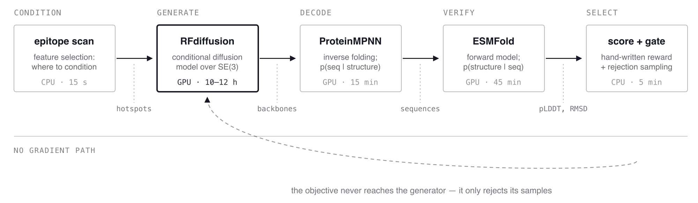
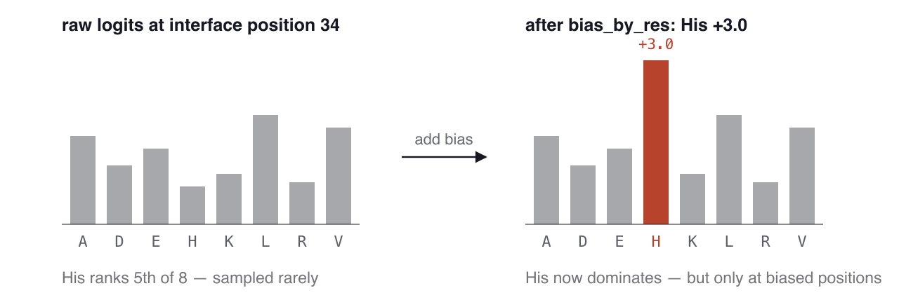
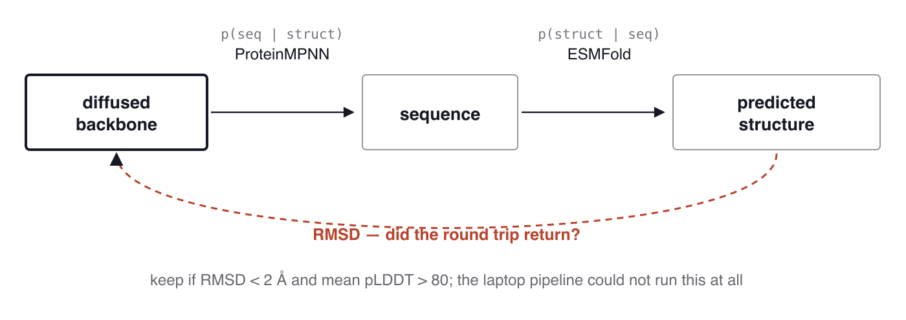
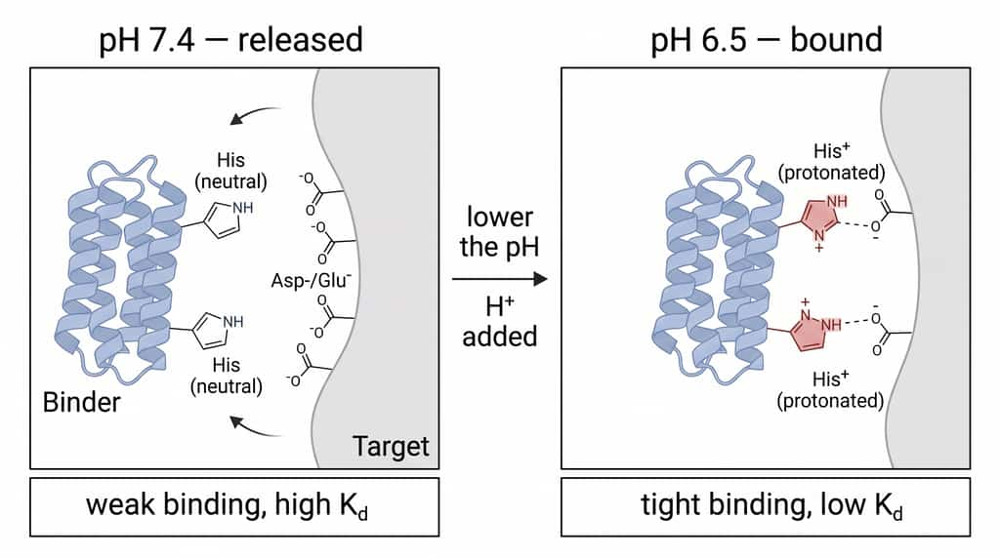
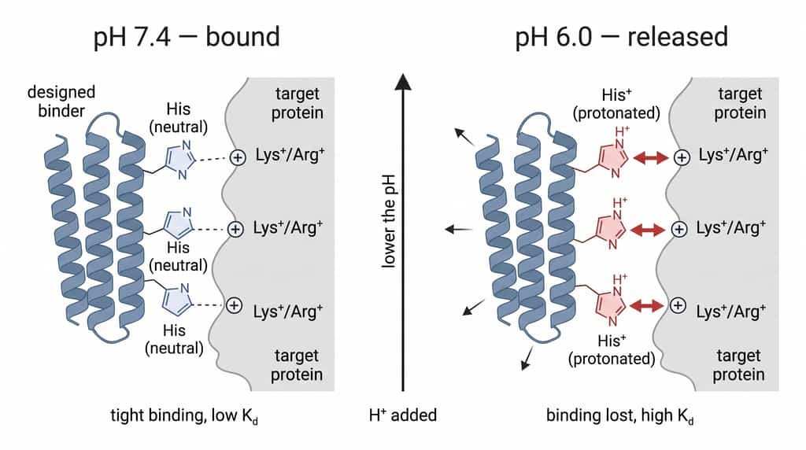
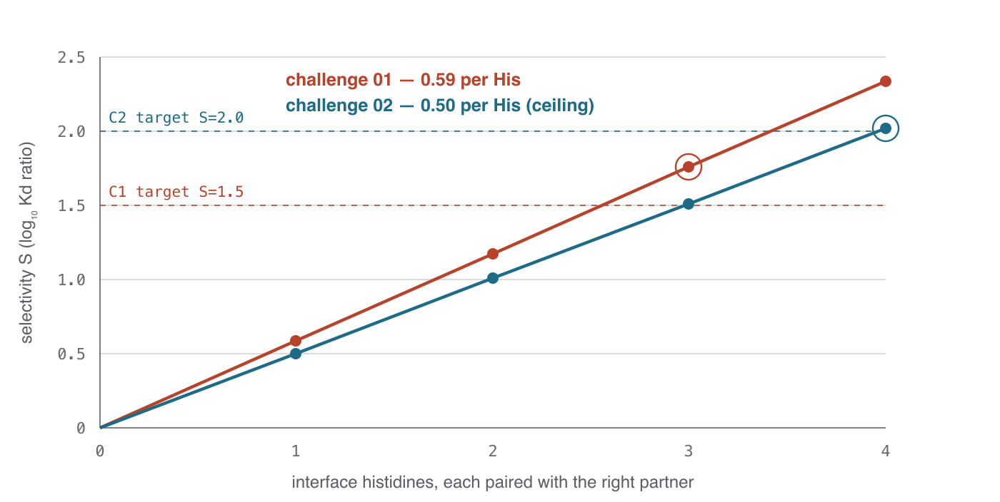
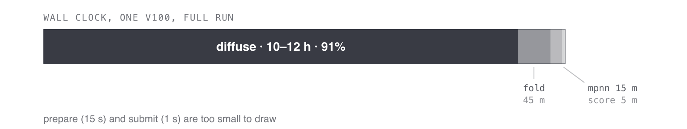
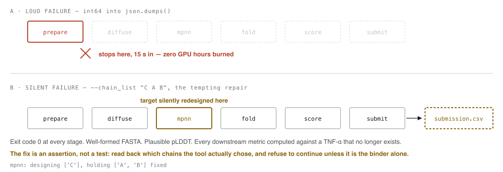

# Conditional Binder Design — the shared workflow

**Anthropic × Adaptyv 2026.** How `chal_1` and `chal_2` are the same machine
learning system with a swapped objective, what each component is doing in ML
terms, and the template that should carry to a third challenge.

This document is the cross-cutting one. For how to actually run either pipeline,
see [`chal_1/README.md`](chal_1/README.md) and [`chal_2/README.md`](chal_2/README.md).

| | challenge 01 | challenge 02 |
|---|---|---|
| target | EGFR Domain III (`6ARU` chain A) | TNF-α homotrimer (`1TNF`) |
| wanted | binds pH 6.5, silent at pH 7.4 | binds pH 7.4, releases at pH 6.0 |
| hardware | 1 × NVIDIA V100 (sm_70) | same |
| dominant cost | ~11 GPU-hours in diffusion | same |

---

## Contents

1. [The system is a cascade, not a model](#1-the-system-is-a-cascade-not-a-model)
2. [What each model is doing](#2-what-each-model-is-doing)
3. [The objective is a ratio](#3-the-objective-is-a-ratio-and-that-changes-everything)
4. [Where the compute goes](#4-where-the-compute-goes-and-why-filter-order-matters)
5. [Two failure modes ML already has names for](#5-two-failure-modes-machine-learning-already-has-names-for)
6. [The template for the next challenge](#6-the-template-for-the-next-challenge)
7. [What this system does not know](#7-what-this-system-does-not-know)

---

## 1. The system is a cascade, not a model

It is tempting to read a binder design pipeline as "an AI that designs proteins."
It is not one model. It is four, chained, with no gradient path between them and
a hand-written scoring function bolted onto the end. The objective we actually
care about — does this protein bind one way at one pH and not at another — never
reaches the generator. It is applied afterwards, as a filter.

In language-model terms this is **best-of-*n* sampling**. You cannot
backpropagate the reward, so you sample a great many candidates and keep the few
that score well. Everything that matters follows from that: sample efficiency is
the binding constraint, the ordering of filters determines cost, and the reward
function is load-bearing in a way a learned loss never is, because nothing is
ever going to correct it.



> Each stage hands a different kind of object to the next. The dashed return path
> is the one that does not exist: no signal from the score flows back into
> diffusion, so the only way to get better designs is to draw more samples and
> throw more of them away. Costs are measured from the challenge-02 V100 run.

---

## 2. What each model is doing

Four architectures, four familiar machine learning jobs wearing unfamiliar names.

| stage | tool | the ML job |
|---|---|---|
| 00 | epitope scan | **feature selection** — fixes the support of everything sampled later |
| 01 | RFdiffusion | **conditional DDPM** over SE(3) frames; hotspots are the prompt |
| 02 | ProteinMPNN | **inverse folding**, p(sequence \| structure); a graph neural network |
| 03 | ESMFold | **forward model**, p(structure \| sequence), used as a verifier |
| 04–05 | score, gate, quota | **rejection sampling** with a diversity constraint |

### 00 — Epitope scan: choosing the conditioning signal

Before any model runs, the pipeline decides *where* on the target to bind, by
scoring surface patches on solvent accessibility, human/mouse conservation, and
the density of the charged residues the chemistry needs.

This is feature engineering, and it is the highest-leverage stage in the system
because it fixes the support of everything sampled later. Pick the wrong patch
and no amount of sampling recovers. It is also the cheapest stage — CPU seconds
against GPU hours — which is the entire argument for doing it carefully.

### 01 — RFdiffusion: a conditional denoising diffusion model

The same family as an image diffusion model, operating on rigid-body frames in
SE(3) rather than pixels. It denoises from Gaussian noise to a protein backbone.
The chosen hotspots enter as a conditioning signal, exactly as a text prompt
conditions an image sampler. It produces geometry only — no sequence.

### 02 — ProteinMPNN: an inverse-folding decoder, and a logit bias

ProteinMPNN reads a backbone and emits per-position amino-acid logits. This is
where chemistry gets injected, through `--bias_by_res_jsonl`: a per-position,
per-amino-acid number added to those logits before sampling.



**This is the same mechanism as `logit_bias` in a language model API**, and it
carries the same two properties:

- It is a **soft** constraint. The model can still decline to place a histidine
  if the structural context argues strongly enough.
- It **trades against the model's own distribution**. Pushing it too hard buys
  histidines at the cost of everything the network knew about foldability. The
  pipeline tracks that trade explicitly as `his_excess`.

Challenge 02 uses a two-sided bias: histidine at interface positions, *plus*
aspartate and glutamate near those histidines as a second lever (see §3).

### 03 — ESMFold closes a cycle-consistency loop

RFdiffusion produced a backbone. ProteinMPNN wrote a sequence *for* that
backbone. ESMFold then predicts a structure *from* that sequence, independently,
with no knowledge of where it came from. If the prediction lands on the backbone
we started with, the sequence genuinely encodes the fold. If it does not,
ProteinMPNN wrote something that scores well under its own model and folds into
something else.



This is **round-trip consistency** — the same construction as back-translation in
machine translation, or cycle loss in unpaired image translation. Here it is used
as a filter rather than a training signal, because there is no gradient path, but
the inference is identical: a composition of two models that should be inverses
is run in both directions, and the discrepancy is the error estimate.

`chal_2_local` could not run this stage at all. It is the most valuable thing the
cluster buys after diffusion itself.

### 04–05 — Score, gate, quota

A hand-written thermodynamic objective ranks survivors; hard gates drop anything
failing a physical floor; a per-backbone quota stops one lucky scaffold from
filling the submission. Top-*k* with a diversity constraint, by another name.

---

## 3. The objective is a ratio, and that changes everything

Neither challenge asks for a binder. Both ask for a **switch**: something that
binds under one condition and not under another. The quantity being optimized is

```
S = log10( Kd(pH high) / Kd(pH low) )
```

a log-ratio between two states — formally the same shape as a contrastive
objective or a margin. Histidine is the only residue with a side-chain pKa inside
the relevant window, so it is the only usable switch; everything else is
scaffolding.

The consequence of optimizing a ratio is one that anyone who has written a reward
function will recognise: **a ratio can be won by making the numerator worse rather
than the denominator better.** A design that binds nothing at all has an
easily-faked selectivity. Both pipelines carry separate affinity-facing terms and
hard gates, and both are still vulnerable — see §5.

### The same mechanism, run in opposite directions

| | challenge 01 (EGFR) | challenge 02 (TNF-α) |
|---|---|---|
| wants | bind pH 6.5, not 7.4 | bind pH 7.4, not **6.0** |
| pH window | 0.9 units | **1.4 units** |
| needs His pKa to | **rise** on binding | **fall** on binding |
| prize residues | conserved Asp/Glu | conserved **Lys/Arg** |
| Asp/Glu at the His are | the mechanism | a **liability** |
| max S per histidine | 0.69 (4.9×) | **0.50 (3.2×)** |
| histidines needed | 2 (floor), 3 for target | **4** (3 with the second lever) |



> **Challenge 01: the switch closes as pH falls.** Neutral histidine has nothing
> to offer the target's carboxylates. Protonate it and each histidine becomes a
> cation paired with an anion — a salt bridge that exists only in acid. Binding
> stabilises the protonated form, which is the same statement as saying the pKa
> rises on binding.



> **Challenge 02: the same switch, wired backwards.** Here the binder is docked
> while the histidines are neutral. Acid protonates them, and each now meets a
> target cation it is repelled by. The design target is not a bond that forms but
> a clash that appears. Pairing these histidines with carboxylates — the entire
> challenge-01 strategy — is actively harmful here.

### The ceiling is analytic, and it is the most valuable result in the project

Take the thermodynamic linkage equation and send the bound-state pKa to infinity.
The selectivity contributed by a single ionizable group converges to the width of
the pH window and no further. For challenge 01 that is 0.9 log units — an 8-fold
Kd shift, absolute best case, forever.

A sharper bound accounts for the fact that free histidine is already partly
protonated at the lower pH, so part of the window is spent before design begins.
At pH 6.0 a free histidine is **71% protonated**, which is why challenge 02's
per-histidine ceiling (0.50) is *worse* than challenge 01's (0.69) despite having
a wider pH window to work with.



> Circled points are where each challenge first clears its target. Challenge 02
> has a second lever — raising the *free*-state pKa as well as suppressing the
> bound one — which lifts the per-histidine figure to 0.90 and brings the
> requirement down to three. **The levers only work together:** a binder
> carboxylate on its own gives 0.27, which is worse than the bare histidine,
> because it leaves the bound pKa above the window.

This is a capacity argument, derived on paper in an afternoon, and it rules out
an entire region of design space before a single GPU-hour is spent. **A
one-histidine design cannot win either challenge.** That is not a modelling
opinion; it is arithmetic.

---

## 4. Where the compute goes, and why filter order matters



One stage is 91% of the wall clock. Everything about how the pipeline is operated
follows from that single ratio:

- the cheap CPU selftest runs first and **refuses to reach `sbatch` on failure**;
- diffusion checkpoints per batch, so a wall-clock kill costs one batch, not a day;
- `LEARN=1` runs 20 backbones through every stage in an hour, to find a stage-04
  bug before spending eleven hours to reach it.

This is the standard cascade-ordering argument from any retrieval or detection
system: put the cheap, high-recall filters first, and never let an expensive stage
discover a bug that a cheap one could have caught.

Sample efficiency in diffusion is the only lever with real leverage on total cost
— which is the argument for spending CPU seconds on a better epitope choice before
spending GPU hours sampling against a worse one.

---

## 5. Two failure modes machine learning already has names for

### Reward hacking in a hand-written reward

Challenge 02's composite score weights cross-reactivity with mouse TNF-α at
**3.0** and the number of target contacts at **0.006**. Designs that achieve a
perfect mouse-identity score of 1.00 frequently get there by *shrinking the
interface* until it no longer touches any of the nine positions where human and
mouse sequences diverge.

This is textbook specification gaming. The proxy — fraction of contacted residues
that are conserved — is maximised by contacting fewer residues, and the term that
should have pushed back is weighted five hundred times lower. The pipeline cannot
see the trade because affinity is not in its objective in any form it can measure.

**Mitigation is manual:** check `n_contacted_target` in `results/design_report.csv`
before trusting any design with `mouse_identity = 1.00`. A learned reward would
have the same problem; writing the reward by hand only makes it visible.

### Silent corruption beats loud crashes

Both challenges have lost a run to a bug. The instructive part is that the two
bugs sit at opposite ends of a spectrum.



**The loud one.** Job `10073878` died on `TypeError: Object of type int64 is not
JSON serializable`, fifteen seconds in, before any GPU work. Annoying, cheap,
obvious. Cost: fifteen seconds.

**The silent one.** The ProteinMPNN driver passed `--designed_chain_list`, a flag
that does not exist, and the crash it caused was the *lucky* outcome. The natural
repair — delete the unknown flag, keep the other — would have handed ProteinMPNN
a chain list meaning "design the binder **and both target protomers**":

```python
"--chain_list", " ".join([designed_chain] + list(fixed_chains)),   # "C A B"
```

`assign_fixed_chains.py` reads `--chain_list` as the chains to *design*. It exits
zero. It writes well-formed FASTA. Downstream, pKa and cross-reactivity are
computed against a TNF-α that has been silently mutated, and `submission.csv`
looks entirely normal.

In ML terms this is **train/eval skew**: the artifact being scored is not the
artifact that will be tested, and nothing in the pipeline notices. It is the same
hazard as a tokenizer mismatch between training and serving, or a label that
leaks into features — the system does not fail, it succeeds at the wrong task.

**The defence is not more tests of the happy path.** It is assertions on
invariants: read back what the tool actually decided and refuse to continue unless
it matches what was asked.

```
mpnn: designing ['C'], holding ['A', 'B'] fixed
```

The same asymmetry holds for the hotspot renumbering check in `chal_2`: an
off-by-one there aims twelve hours of diffusion at the wrong face of the protein,
and every design still looks fine.

---

## 6. The template for the next challenge

The architecture generalises because **the generator knows nothing about pH.**
RFdiffusion samples backbones against an epitope; ProteinMPNN writes sequences;
ESMFold checks them. None of those three stages contains a single line specific to
histidine, to pH, or to either target. All of the task lives in the conditioning
and the reward.

| component | status | what changes between challenges |
|---|---|---|
| **RFdiffusion** | fixed | Nothing. Same checkpoint, same protocol. Only the contig string and hotspot list differ, and both are generated. |
| **ProteinMPNN** | fixed | Nothing in the model. The bias array it consumes is rebuilt per challenge. |
| **ESMFold** | fixed | Nothing. Self-consistency is task-agnostic. |
| **Epitope scoring** | *rewrite* | Which residues count as a prize. Conserved Asp/Glu for ch. 01; conserved Lys/Arg for ch. 02, where carboxylates become a penalty. |
| **Logit bias** | *rewrite* | Sign and partner logic. Ch. 02 adds a second lever, biasing acidic residues *on the binder* near the biased histidines. |
| **pKa model** | *rewrite* | Which environment features raise the bound-state pKa and which suppress it — the full table of Δ-pKa increments inverts. |
| **Objective** | *rewrite* | Direction of the ratio, the pH pair, the target S, and the minimum switch count implied by the analytic ceiling. |
| **Target handling** | *per-target* | Chain count, cropping, numbering offsets. TNF-α is an obligate trimer whose site spans two protomers; EGFR Domain III is one chain. |

### Checklist for a third challenge

1. **Derive the ceiling first.** Before any code, work out the maximum
   selectivity one switch residue can contribute and divide the target by it. If
   the answer exceeds about four switches, the strategy is wrong and no amount of
   sampling will rescue it.
2. **Name the prize residue and its liability.** Every conditional-binding
   mechanism has a partner that makes it work and a partner that kills it.
   Challenge 02's liability was challenge 01's mechanism.
3. **Decide what the reward cannot see.** Write it down before the run, not
   after. In both challenges to date, the answer was affinity.
4. **Add an invariant check per external tool.** Not a test that the tool runs —
   an assertion that it did what was asked, read back from its own output.

---

## 7. What this system does not know

Stated plainly, because a document that only explains the architecture tends to
flatter it.

**There is no interface prediction.** ESMFold folds the binder *alone*. Nothing in
either pipeline predicts the complex — no AF2-multimer, no Boltz, no co-folding of
binder and target. This is the field-standard filter for de novo binders and it is
the largest single gap: the verifier is weakest exactly along the axis the
challenge is scored on.

**The reward has no calibration set.** Every Δ-pKa increment in the scoring
function is hand-set from structural intuition. They are not fitted to measured
pKa values, because no such set was assembled. The score ranks designs; it does
not predict numbers, and absolute pKa values should never be quoted. In ML terms:
an unvalidated reward model with no held-out evaluation.

**Nothing here predicts Kd.** S is a ratio. A design can have excellent predicted
selectivity and bind nothing at all. Affinity is addressed only indirectly, as
"bury the right amount of surface in the right place" — which is why the
reward-hacking failure in §5 is not a corner case but the expected behaviour of
this objective.

**Independence is assumed.** Per-histidine contributions are summed, which assumes
the sites do not interact. A 7 Å minimum separation is enforced to make that
roughly true. "Roughly" is doing real work in that sentence.

---

## Provenance of the figures

| figure | source |
|---|---|
| `switch-egfr.jpg`, `switch-tnf.jpg` | generated with BioRender |
| all other figures | hand-authored SVG, rasterised with `rsvg-convert`; sources in `docs/figures/*.svg` where kept |

Numeric values are taken from the two pipelines' own derivations and run logs:
per-group selectivity ceilings and histidine floors from
`chal_2/src/tnf_hpc/linkage.py`, stage timings from the challenge-02 V100 run, and
the composite-score weights from `chal_2/src/tnf_hpc/design.py`.
